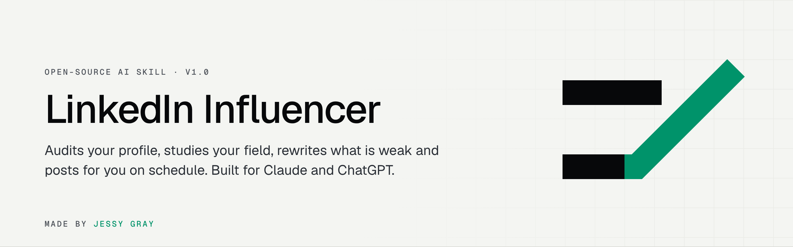
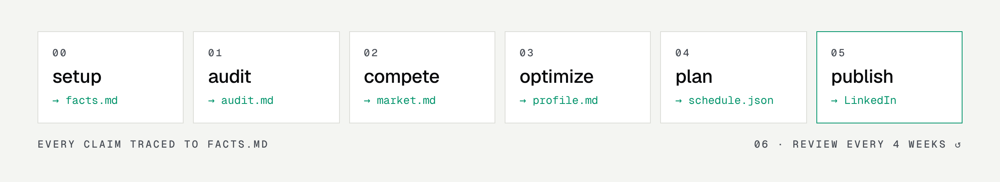

<p align="center">
  <picture>
    <source media="(prefers-color-scheme: dark)" srcset="assets/banner-dark.png">
    
  </picture>
</p>

<p align="center">
  <a href="#quick-start">Quick start</a> ·
  <a href="#how-it-works">How it works</a> ·
  <a href="#automatic-posting">Automatic posting</a> ·
  <a href="#faq">FAQ</a>
</p>

<p align="center">
  
  
  
  
</p>

---

Most people know they should post on LinkedIn. Few do it every week, and fewer know what to post, when, or why their profile isn't getting views.

**LinkedIn Influencer** is a skill you give to your AI assistant. It reads your profile, looks at who is doing well in your field, tells you what to fix, writes your posts in your own voice and publishes them at the right times. You set it up once.

It has one hard rule: **it never makes things up.** Every job, number and result in your profile and posts comes from a facts file you approve. If something is missing, it asks.

## How it works

<picture>
  <source media="(prefers-color-scheme: dark)" srcset="assets/flow-dark.png">
  
</picture>

| Step | You say | You get |
| --- | --- | --- |
| **0 · Setup** | "Set me up" and upload your LinkedIn PDF | `facts.md`: your verified facts, goals, audience and time zone |
| **1 · Audit** | "Audit my profile" | A score out of 100 and the 5 fixes worth the most |
| **2 · Compete** | "Who's winning in my field?" | 5 people to learn from, what works for them, gaps you can own |
| **3 · Optimize** | "Fix my profile" | Paste-ready headline, About, experience, skills and banner text |
| **4 · Plan** | "Plan my posts" | 4 weeks of posts with dates and times for your audience |
| **5 · Publish** | "Post them" | Posts queued and published on time, no approval step |
| **6 · Review** | "How did last month go?" | What worked, what to change, the next 4 weeks |

Or just say **"do everything"**.

Each step writes one small file to a `linkedin/` folder, and the next step starts from that file instead of redoing the research. That is most of why it's cheap to run: the skill loads one short instruction file per step, reuses research for 30 days, and keeps chat replies to a few lines.

## Quick start

### Claude Code

```bash
git clone https://github.com/JessyGray/linkedin-influencer.git
cp -r linkedin-influencer/skill/linkedin-influencer ~/.claude/skills/
```

Then open Claude Code in any folder and say *"use linkedin-influencer, set me up"*.

### Claude.ai (web and desktop)

1. Zip the `skill/linkedin-influencer` folder.
2. **Settings → Capabilities → Skills → Upload skill**, and pick the zip.
3. Start a chat: *"Set up my LinkedIn"* and attach your profile PDF.

### ChatGPT

Create a Custom GPT with the files in [`gpt/`](gpt). The [setup guide](gpt/README.md) takes about 5 minutes. The same instructions work as a Gemini Gem or a system prompt in other assistants.

### Getting your profile PDF

On LinkedIn, open your profile → **More** → **Save to PDF**. This is the safest way to give the AI your profile. It doesn't need your password or a scraper.

## Automatic posting

The skill plans and writes posts on its own. To publish them without you touching anything, deploy the small **publisher** in [`publisher/`](publisher). It runs free on Vercel and Supabase and uses LinkedIn's official API.

```
AI writes schedule.json ──► publisher queue (Supabase) ──► every 15 min: post what's due ──► LinkedIn
```

<details>
<summary><b>Setup, step by step (about 20 minutes)</b></summary>

<br>

**1. LinkedIn app**

- Go to [linkedin.com/developers/apps](https://www.linkedin.com/developers/apps) → **Create app**. LinkedIn asks for a Company Page; your own small page is fine.
- **Products** tab: add **Share on LinkedIn** and **Sign In with LinkedIn using OpenID Connect**.
- **Auth** tab: copy the Client ID and Client Secret. Add the redirect URL `https://<your-app>.vercel.app/api/auth/callback`.

**2. Supabase**

- Create a free project at [supabase.com](https://supabase.com).
- **SQL Editor** → paste [`publisher/supabase/schema.sql`](publisher/supabase/schema.sql) → **Run**.
- Pick a long random string for `DB_SECRET` and run:
  ```sql
  insert into li_private.config (key, value) values ('db_secret', 'YOUR_DB_SECRET');
  ```

**3. Vercel**

- Import this repo at [vercel.com/new](https://vercel.com/new) and set **Root Directory** to `publisher`.
- Add the environment variables from [`publisher/.env.example`](publisher/.env.example) and deploy.

**4. Connect LinkedIn**

- Open `https://<your-app>.vercel.app/api/auth/start?key=YOUR_ADMIN_KEY` and approve.
- Check it worked: `https://<your-app>.vercel.app/api/status?key=YOUR_ADMIN_KEY`

**5. Post on time**

Vercel's free plan runs its cron once a day, which is enough if you post at one fixed hour. For exact times, use the included GitHub Action that checks every 15 minutes:

- In your copy of this repo: **Settings → Secrets and variables → Actions**, add `PUBLISHER_URL` and `PUBLISHER_KEY` (your `ADMIN_KEY`).
- Open the **Actions** tab and enable workflows. GitHub turns scheduled workflows off on forks until you do.

**6. Tell the AI**

Give your assistant `PUBLISHER_URL` and `PUBLISHER_KEY` (Claude Code: put them in your shell environment; ChatGPT: add the Action from [`gpt/openapi.yaml`](gpt/openapi.yaml)). From then on, *"post them"* queues the plan.

</details>

### Publisher API

| Method | Path | What it does |
| --- | --- | --- |
| `POST` | `/api/queue` | Queue posts. Body is the `schedule.json` the skill writes. |
| `GET` | `/api/queue` | Upcoming and recent posts |
| `DELETE` | `/api/queue?id=12` | Cancel a scheduled post |
| `GET` | `/api/status` | Connection, token expiry, queue counts |
| `GET` | `/api/auth/start` | Connect or reconnect LinkedIn |

Every call needs `Authorization: Bearer <ADMIN_KEY>` or `?key=<ADMIN_KEY>`. Tables are locked with row-level security, and the database only answers through functions that check a separate secret.

## What it will not do

These limits are on purpose. Each one protects your account or your reputation.

- **Invent experience.** No fake jobs, clients, numbers or results, ever. Recruiters check, and one invented claim costs more than an empty section.
- **Scrape LinkedIn.** Bulk-reading profiles breaks LinkedIn's terms and gets accounts restricted. Competitor research uses public web search.
- **Fake engagement.** No automated likes, comments, connection requests or DMs. Those are the fastest way to get flagged. Only your own posts are automated, through the official API.
- **Edit your profile through the API.** LinkedIn doesn't allow it. You get copy you can paste in a few minutes, or Claude can apply it in your browser if you connect one.

## FAQ

<details>
<summary><b>Will my posts sound like AI?</b></summary>
<br>
The skill learns from 2 or 3 samples of your own writing and has a list of phrases and habits it won't use (em dashes, "delve", "game-changer", emoji bullet lists). Every post goes through a self-check before it's queued. Read the first few weeks anyway and tell it what doesn't sound like you. It gets closer fast.
</details>

<details>
<summary><b>Why is there no approval step?</b></summary>
<br>
Because the main reason people stop posting is the extra step. The self-check is the gate instead: a post with a missing fact, a banned phrase or an open question is fixed or dropped, never published. You can still see the queue and cancel anything with <code>DELETE /api/queue?id=…</code>.
</details>

<details>
<summary><b>How often do I need to do anything?</b></summary>
<br>
Every 4 weeks: share your post stats so the next month gets better. Every 60 days: click the reconnect link, because LinkedIn tokens expire. <code>/api/status</code> warns you a week before.
</details>

<details>
<summary><b>What does it cost?</b></summary>
<br>
The skill is free. The publisher fits in the free plans of Vercel, Supabase and GitHub Actions. You need a Claude or ChatGPT plan that supports skills or Custom GPTs.
</details>

<details>
<summary><b>Can I post images, documents or polls?</b></summary>
<br>
The plan includes them, marked <code>"manual": true</code>. The publisher posts text only, so you post those yourself. Text posts do well on LinkedIn, so this covers most of the calendar.
</details>

## Project structure

```
skill/linkedin-influencer/   Claude skill: SKILL.md + one reference file per step
  references/                audit rubric, competitor method, profile formulas, writing rules, timing, publishing
  templates/                 facts.md and schedule.json
gpt/                         Custom GPT instructions, Action schema, setup guide
publisher/                   Vercel functions + Supabase schema for automatic posting
.github/workflows/           15-minute publish trigger
assets/                      banner, mark, diagrams
```

## Roadmap

- [ ] Image posts through the publisher
- [ ] Pull post analytics automatically where the API allows it
- [ ] Ready-made `.zip` for Claude.ai in Releases
- [ ] More languages for the writing rules

Ideas and pull requests are welcome. Please open an issue first for anything big.

## License

[MIT](LICENSE). Use it, change it, sell your services with it.

Not affiliated with or endorsed by LinkedIn. LinkedIn is a trademark of LinkedIn Corporation.

---

<p align="center">
  
  
  <br>
  <sub>Made by <a href="https://jessygray.vercel.app">Jessy Gray</a></sub>
</p>
